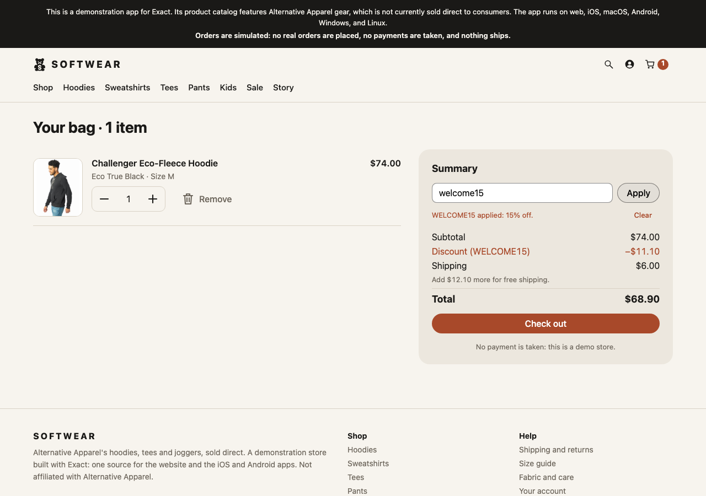
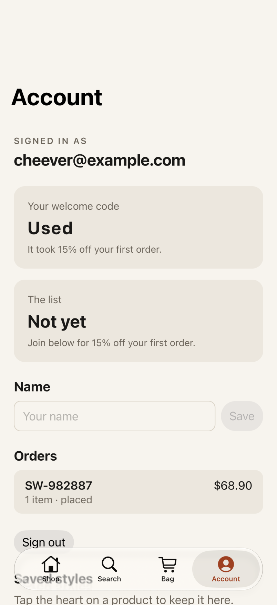

# Softwear

A clothing store for the web and installed apps: a searchable catalogue, product photos, size and colour choices, a saved bag, checkout and an account. Its backend is a [Quickback](https://quickback.dev) project in `backend/`: a Cloudflare Worker with D1 and Better Auth that serves the catalogue and stock, signs shoppers in, keeps their bags and saved styles, prices orders and checks promo codes. `backend/README.md` describes it and its security rules. Based on [ccheever/softwear](https://github.com/ccheever/softwear) at `1949c46`.

Keywords: store, shop, shopping, ecommerce, clothing, apparel, catalogue, catalog, product, inventory, stock, size, colour, filters, search, bag, cart, checkout, promo code, discount, account, sign-in, password, bearer token, secret store, orders, favorites, saved styles, photo gallery, pinch zoom, view transition, native module, REST, backend, Quickback, Cloudflare Workers, D1, Better Auth, server rendering, tabs, dark mode.

Against the backend, on the web and on an iPhone simulator (`docs/` has every step):

## What it shows, and where

| Behaviour | Where |
| --- | --- |
| Home, catalogue and story pages rendered at build time; product pages rendered per request; the catalogue read from the backend at launch | `app.contract`, `routes` and `render`; `app.ts`, `loadCatalog`; `backend/quickback/features/products` |
| Category, audience, size and price filters kept in the URL; search | `app.contract`, `setCat`, `setGender`, `setSize`, `setSort`, `search` |
| Product photos, colour and size choices, saved styles and related products | `app.contract`, `Photo`, `Frame`, `pickColor`, `pickSize`, `toggleSaved` |
| Stock checked across bag lines; orders priced, discounted and taken from stock on the server | `app.ts`, `loadBagStock`, `checkPromo`, `placeOrder`; `backend/quickback/features/orders/actions/checkout.ts` |
| Sign-in with an email and password; the session token kept in the secret store and sent as a bearer | `app.ts`, `signIn`, `grants`, `secret.keep`; `app.contract`, `signIn`, `afterSignIn` |
| A bag and saved styles that follow the account to another device | `app.ts`, `loadBagStock`, `syncSaved`; `backend/quickback/features/bag-items`, `saved-styles` |
| Rows a shopper owns, fields no client may write, masked addresses, staff-only transitions | `backend/README.md`, "The security model"; `tools/server.test.ts` |
| Checkout that preserves subsequent bag edits while a reply is pending | `app.contract`, `placeOrder`; `tools/browser.test.ts` |
| The mailing list, restock requests, order history and retryable order failures | `app.ts`, `subscribe`, `notifyMe`, `loadOrder`; `regressions.test.contract` |
| Native tab stacks, haptics and photo navigation transitions | `app.contract`, `navigationSource`, `sharedElement`, `haptic` |
| Pinch, pan and double-tap photo zoom, with pull-to-dismiss on web and iOS | `modules/`, the `zoom-image` native view |
| Bands, photos and card rails to the screen's edges, with text and controls kept in the safe area, clear of rounded corners | `app.contract`, `viewport-fit`, `Wrap`, `Rail`, `-exact-safe-area-corners-inset` |
| Brand colours and bear mark in light and dark mode | `app.tamber`, `assets/brand/`, `tools/logo.ts` |

## Files

`app.contract` contains the pages and state; `app.ts` calls the API. `backend/` is the API: its tables and rules are in `backend/quickback/`, and `backend/src/` is what Quickback compiled them to. `server.ts` runs it for development. `catalog.ts` is the catalogue the backend is seeded from and the one a build renders ahead. `assets/` contains the shipped photos and brand; `photos/` retains original images and source manifests. `modules/` implements the photo viewer for Apple, Android and web hosts. `app.test.contract` and `regressions.test.contract` drive the UI; `tools/` contains isolated API and browser regression checks. `docs/` holds screenshots of a sign-up, a bag, a checkout and an order on the web and on iOS. `app/README.md` describes the app in more detail.

## Adapt

Create a copy with `bun new.mjs softwear <path> --name <name> --bundle-id <id>`, then copy `softwear/backend` to `<path>/backend`: `new.mjs` copies only `app/`. In that app:

- Run `npm install` in `backend` once. Run `bun server.ts`, then `bun exact.mjs web` in another terminal. `.env` defaults to a local API on port 8787. Set `API_BASE_URL` in the environment or `.env.local` before building for another server; a physical phone needs a reachable address.
- Change a table, a rule or checkout in `backend/quickback/`, then `npx @quickback-dev/cli build` there. `backend/README.md` has the rest.
- Replace `CATALOG`, the product images, the copy in `app.contract`, and the brand in `app.tamber` and `assets/brand/`.
- Take payment at checkout, verify a new account's address and send the list's emails before using real customers or orders.
- Run `bun test tools/server.test.ts tools/data.test.ts` for isolated API tests; they start the backend themselves on a database of their own. For browser regressions, set `EXACT2` to your Exact checkout, run `bun exact.mjs web-build --out target/browser-test`, then `EXACT_WEB_DIST=target/browser-test bun test tools/browser.test.ts`.
- `bun exact.mjs test` and `verify` start an isolated API themselves. If the default API port is already occupied, give them a free port, with the next one up free too: `API_BASE_URL=http://127.0.0.1:18789 bun exact.mjs verify`.
- To put the app on someone's iPhone, deploy the backend to Cloudflare (`npx @quickback-dev/cli deploy` in `backend`, which has not been run for this template), add the site's origin to `trustedOrigins` in `backend/quickback/quickback.config.ts`, then run `API_BASE_URL=https://<your server> bun exact.mjs share`, which prints an AppDrop link. The build is a release, so it needs `deploy.signing.keys` in `app.json`, or `"deploy": { "store": { "ios": "0" } }` for a build that takes no over-the-air updates.

## Verified

With the Quickback backend, on the pinned Exact, in `softwear/app` made runnable by `bun new.mjs --develop softwear`:

- `bun exact.mjs test web`: 30 UI tests pass (22 in `app.test.contract`, 8 in `regressions.test.contract`).
- `bun exact.mjs test ios app.test.contract` on an iPhone 17 Pro simulator, iOS 27.0: 6 tests pass, among them a sign-up, a bag, WELCOME15, a checkout and the order read back, all against the backend.
- `bun test tools/server.test.ts tools/data.test.ts`: 8 tests pass. `tools/browser.test.ts`: 4 pass.

Not run since the backend replaced the Bun server: `bun exact.mjs verify` and `verify ios`, the regression file on iOS, Android, and an app made by `new.mjs` rather than `--develop`. The backend has been run only locally, under `wrangler dev`; it has not been deployed.

## Needs

Exact `1cbce180d4256414368de13d39d5e3ff01292f1c`, pinned in `exact.json` on the published `main` branch of `expo/exact`. The backend needs Node and npm (it installs Wrangler, which runs the Worker and its D1 locally); Bun starts it. Changing the backend needs the Quickback CLI and an account with it. Browser regression tests use the Exact checkout's Playwright installation. Apple and Android builds require their platform toolchains.

## Limits

This is a demonstration, not a production store: checkout takes no payment, sign-up does not verify an address, and the mailing list and restock requests send no email. The backend's sign-in rate limits are raised for the test run. Product descriptions and retailer photos describe Alternative Apparel; the demo is not affiliated with it. Photos are retained for demonstration with their source manifests; replace them for your own store. Android is implemented but not certified by this template's checks. `QUEUE.md` lists follow-up work.
